<div align="center">

# ⚡ Core Isolation on a Dual-Core Microcontroller

### A web-connected hardware controller on the ESP32-S3 with FreeRTOS<br/>where the two CPU cores **never wait for each other**

[](https://www.espressif.com/en/products/socs/esp32-s3)
[](https://www.freertos.org/)
[](https://github.com/espressif/arduino-esp32)
[](#-how-the-cores-talk)


[](LICENSE)

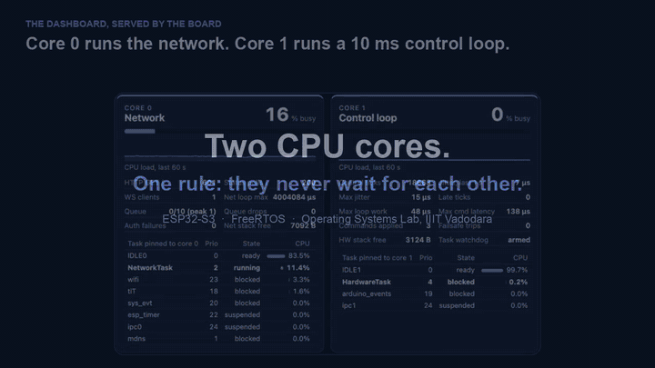

**[Results](#-results) · [Architecture](#%EF%B8%8F-architecture) · [Dashboard](#%EF%B8%8F-the-live-dashboard) · [Quick start](#-quick-start) · [API](#-api) · [Report & slides](#-report-slides--video)**

</div>

---

## 🧠 The idea in 20 seconds

A connected controller does two very different jobs:

| | Control job | Network job |
|---|---|---|
| **What** | read inputs, switch relays | Wi-Fi, TCP/IP, HTTP, WebSocket |
| **Size** | ~50 µs of work | 25 KB web pages, bursty |
| **Deadline** | **every 10 ms, on time** | a few ms late is fine |

On one core, every network burst pushes the next control step late. That's **jitter**.

The ESP32-S3 has **two** cores, so:

> **Core 0** gets everything network. **Core 1** gets *only* the 10 ms control loop.
> Data crosses between them through one-way, single-writer channels, so **no task ever waits for the other core.**

---

## 📊 Results

Measured on the real board. Same firmware, same 500 web requests; the only change is which core runs the loop (`-DHARDWARE_CORE=0`).

| | **Loop on Core 1** 🟣 | **Loop on Core 0** 🔴 |
|---|:---:|:---:|
| Ticks within 50 µs, idle | **100 %** | 88.4 % |
| Ticks within 50 µs, HTTP stress | **100 %** | 64.0 % |
| Ticks more than 1 ms late, HTTP stress | **0** | 586 |
| Worst jitter, HTTP stress | **14 µs** | 9,254 µs |
| Longest single loop iteration | **52 µs** | 2,593 µs |

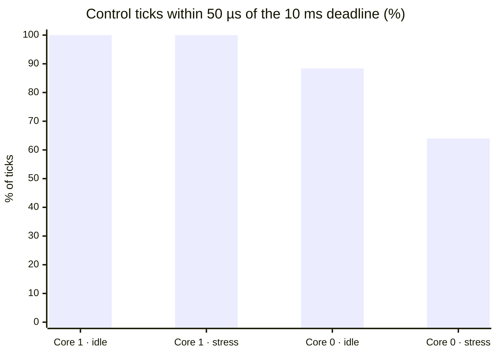

<table>
<tr>
<td width="50%"><b>🟣 Loop on Core 1</b>: Core 0 is 57 % busy serving HTTP, Core 1's ticks stay perfectly even.<br/>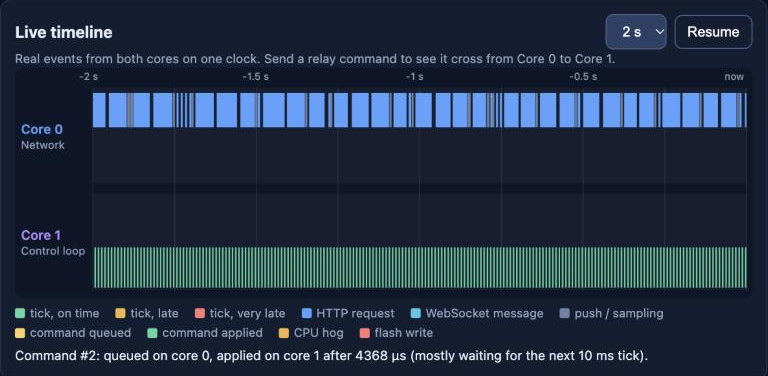</td>
<td width="50%"><b>🔴 Loop on Core 0</b>: the ticks now share the core with Wi-Fi and TCP/IP. Orange/red ticks are late.<br/>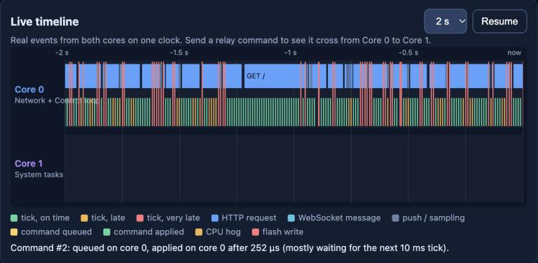</td>
</tr>
</table>

### 🔥 Stress tests built into the firmware

| Experiment | What happened | Number |
|---|---|---|
| **CPU hog on Core 0** (priority 5, 1 s) | network lane freezes, control loop doesn't notice | worst jitter **7 µs** |
| **CPU hog on Core 1** (priority 5, 1 s) | loop stops, then `vTaskDelayUntil` runs the missed periods back-to-back | **1 s** stall + **100** catch-up ticks |
| **Flash write** (4 KB to NVS) | cache disabled, other core parked: **both cores pause** | Core 1 stalled **24.6 ms** |
| **40 relay commands** | each waits for the next tick: latency uniform on 0–10 ms | median **5.15 ms**, 0 dropped |

<table>
<tr>
<td width="50%"><b>Hog on Core 0</b><br/>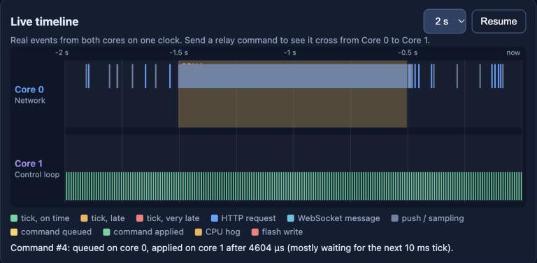</td>
<td width="50%"><b>Hog on Core 1</b><br/>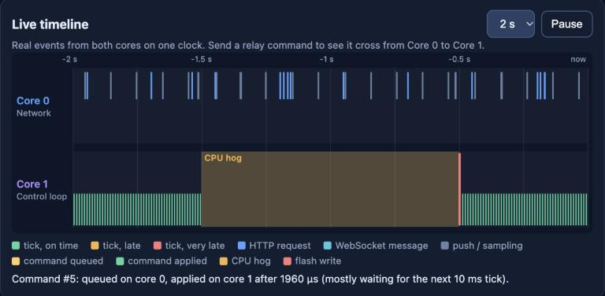</td>
</tr>
<tr>
<td width="50%"><b>Flash write pauses both cores</b><br/>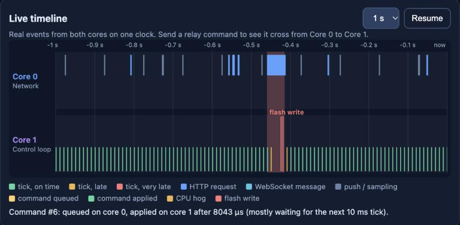</td>
<td width="50%"><b>Every command, from queued (Core 0) to applied (Core 1)</b><br/>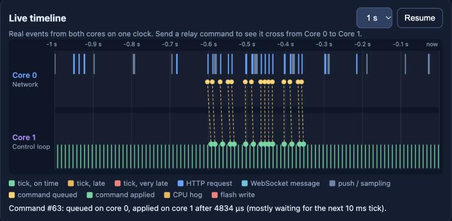</td>
</tr>
</table>

### 🕵️ Plot twist: our monitor was the bug

v3.0 still showed **~22 late ticks a minute** with nothing happening on the network. The timeline pointed at… the dashboard itself. Once a second it read the FreeRTOS task table (to show CPU load per core). That read takes **1.76 ms** and holds a kernel lock **both cores share**. When it overlapped a tick, the tick slipped by exactly one RTOS tick (1 ms).

| Fix attempt | Late ticks (> 1 ms) |
|---|:---:|
| v3.0: read the task table whenever | 🔴 22 |
| read only within 4 ms *after* a tick | 🟠 6 under load |
| + suspend task switching between check and read | 🟠 8 under load |
| + never force the read on a timeout (**v3.1**) | 🟢 **0** |

> Pinning tasks to cores isolates **scheduling**, not **hardware**. Shared locks, caches and flash still couple the cores, and instrumentation is never free.

---

## 🏗️ Architecture

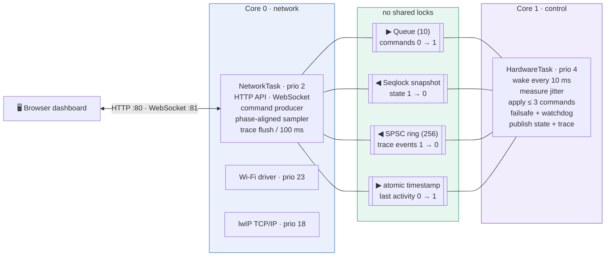

### 🔁 How the cores talk

| Channel | Direction | Why Core 1 never waits |
|---|---|---|
| **FreeRTOS queue** (10 commands) | Core 0 → Core 1 | Core 0 sends with timeout `0`; Core 1 reads with timeout `0`, max 3 per tick. Full queue → drop, count, HTTP 503 |
| **Sequence lock** | Core 1 → Core 0 | Core 1 writes (counter odd → copy → counter even). Core 0 copies and retries if the counter moved |
| **SPSC ring buffer** (256 × 24 B) | Core 1 → Core 0 | producer owns `head`, consumer owns `tail`; acquire/release ordering only |
| **`std::atomic` timestamp** | Core 0 → Core 1 | last authenticated activity, feeds the optional failsafe |

<details>
<summary><b>🔬 The seqlock, in 15 lines</b></summary>

```cpp
void publish(const HwSnapshot &s) {            // Core 1 only, never waits
  uint32_t v = seq.load(std::memory_order_relaxed);
  seq.store(v + 1, std::memory_order_relaxed);   // odd: write in progress
  std::atomic_thread_fence(std::memory_order_release);
  memcpy((void *)&data, &s, sizeof(HwSnapshot));
  seq.store(v + 2, std::memory_order_release);   // even: consistent
}
bool read(HwSnapshot &out) const {               // any reader, may retry
  for (int attempt = 0; attempt < 8; ++attempt) {
    uint32_t s1 = seq.load(std::memory_order_acquire);
    if (s1 & 1) continue;
    memcpy(&out, (const void *)&data, sizeof(HwSnapshot));
    std::atomic_thread_fence(std::memory_order_acquire);
    if (seq.load(std::memory_order_relaxed) == s1) return true;
  }
  return false;
}
```
</details>

<details>
<summary><b>⏱️ The command journey</b></summary>

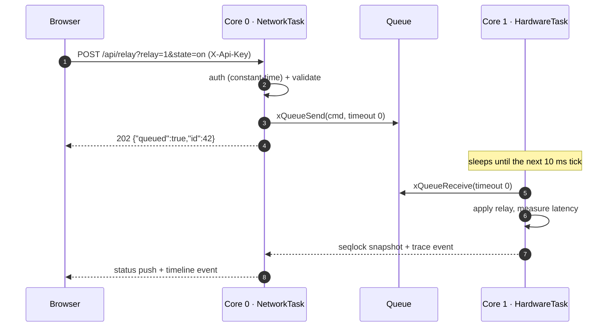
</details>

---

## 🖥️ The live dashboard

Served by the board itself. No app, no cloud.

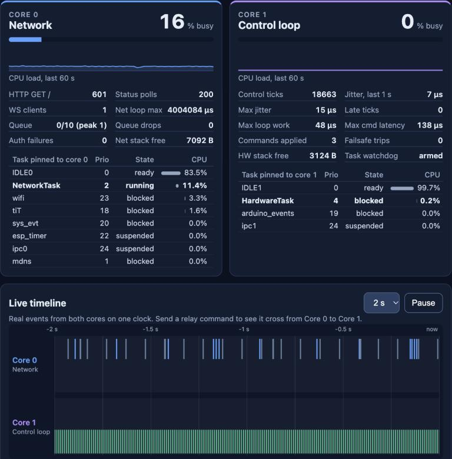

- **CPU load per core**: `load = 1 − idle-task time ÷ elapsed`, from FreeRTOS run-time stats
- **Every task, grouped by core**: priority, state, CPU %, free stack
- **Two-lane live timeline**: HTTP/WS work on Core 0, every 10 ms tick on Core 1, a dashed line from each queued command to where it was applied
- **Built-in experiments**: CPU hog on either core, flash write, HTTP stress test
- **Jitter histogram + 60 s history**, relays, system info (chip, temp, heap, PSRAM, reset reason)
- **Works without WebSockets**: falls back to HTTP polling (`/api/trace`), with events placed on the device clock

---

## 🚀 Quick start

### 1. Hardware
Any **ESP32-S3** board. Ours: Lonely Binary **ESP32-S3 N16R8** (16 MB flash, 8 MB OPI PSRAM). Relays are **virtual by default**: no wiring needed to try it.

### 2. Software
- Arduino IDE 2 + **esp32 by Espressif 3.x** (tested with **3.3.12**)
- Library: **WebSockets** by Markus Sattler (`arduinoWebSockets`)

### 3. Board settings (Tools menu)
| Setting | Value |
|---|---|
| Board | ESP32S3 Dev Module |
| Flash Size | 16MB (128Mb) |
| PSRAM | OPI PSRAM |
| USB CDC On Boot | Enabled |
| Arduino Runs On / Events Run On | Core 1 |

### 4. Credentials
```bash
cp secrets.h.example secrets.h
```
Edit `secrets.h` with your Wi-Fi and a long random API token. It's in `.gitignore`.

### 5. Flash and open
Upload, open the Serial Monitor at **115200**, and browse to the printed address or **http://esp32-controller.local/**. Paste the API token into the dashboard to use the buttons.

<details>
<summary><b>⚙️ Compile-time options</b></summary>

| Define | Default | Meaning |
|---|---|---|
| `HARDWARE_CORE` | `1` | core for the control loop; `0` reproduces the comparison above (`-DHARDWARE_CORE=0`) |
| `ENABLE_PHYSICAL_RELAYS` | `0` | drive real relays on GPIO 4–7 |
| `RELAY_ACTIVE_HIGH` | `1` | `0` for active-low relay boards |
| `ENABLE_TIMING_GPIO` | `0` | toggle GPIO 16 every tick, for an oscilloscope |
| `ENABLE_HEARTBEAT_LED` | `0` | blink the on-board RGB LED from Core 1 |
| `REQUIRE_AUTH` | `1` | token required for state-changing calls |
| `FAILSAFE_TIMEOUT_MS` | `0` | relays off after this much silence (`0` = off) |
</details>

---

## 🔌 API

All state-changing calls are `POST` with header `X-Api-Key: <token>`.

| Method | Endpoint | |
|---|---|---|
| `GET` | `/` | dashboard |
| `GET` | `/api/status` | metrics, relays, system info |
| `GET` | `/api/tasks` | per-core load + task table |
| `GET` | `/api/trace?since=N` | timeline events (HTTP fallback) |
| `POST` | `/api/relay?relay=1&state=on` | one relay |
| `POST` | `/api/all?state=off` | all relays |
| `POST` | `/api/reset` | reset maxima + histogram |
| `POST` | `/api/ping` | keep-alive for the failsafe |
| `POST` | `/api/hog?core=0&ms=500` | CPU hog experiment (50–2000 ms) |
| `POST` | `/api/flashtest` | flash-write experiment |

**WebSocket** `ws://<ip>:81/`: send `AUTH:<token>`, then `R1:ON`, `ALL:OFF`, `RESET`, `PING`, `STATUS`, `HOG:0:500`, `FLASH`. The board pushes `status`, `tasks` (1 Hz) and `trace` (10 Hz) messages.

```bash
curl -X POST -H "X-Api-Key: $TOKEN" "http://esp32-controller.local/api/relay?relay=1&state=on"
```

---

## 🧭 How we got here: 12 phases

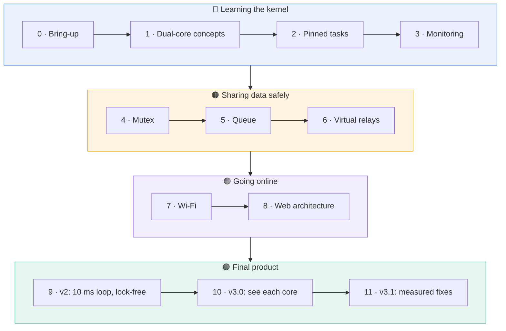

| Phase | OS concept | Key result |
|---|---|---|
| 2 | `xTaskCreatePinnedToCore`, priorities | network task on Core 0, control on Core 1 |
| 4 | mutex, race conditions | 2–3 µs lock waits, but Core 1 can block on Core 0 |
| 5–6 | producer–consumer queue | 18 µs latency, but the consumer only runs on a command |
| 9 | periodic scheduling, lock-free sharing | `vTaskDelayUntil` loop, mutex removed, seqlock |
| 10–11 | observability, observer effect | per-core view, then 22 → 0 late ticks |

---

## 📁 Project structure

```
Multicore_Web_Controller/
├── Multicore_Web_Controller.ino   # the whole firmware + embedded dashboard (v3.1)
├── secrets.h.example              # copy to secrets.h (git-ignored)
├── LICENSE                        # MIT
├── docs/images/                   # README media (real captures from the board)
└── Report/
    ├── ESP32-S3_Multicore_Report.pdf          # IEEE-format report
    ├── ESP32-S3_Multicore_Report_LaTeX.zip    # LaTeX source (IEEEtran)
    ├── ESP32-S3_Multicore_Presentation.pptx   # 20-slide deck (+ .pdf)
    └── ESP32-S3_Multicore_Showcase.mp4        # 45 s demo video
```

## 📚 Report, slides & video

- 📄 **[IEEE-format report](Report/ESP32-S3_Multicore_Report.pdf)**: design, 12 phases, 7 experiments, full source in the appendix
- 🎞️ **[Presentation](Report/ESP32-S3_Multicore_Presentation.pdf)** ([.pptx](Report/ESP32-S3_Multicore_Presentation.pptx))
- 🎬 **[Showcase video](Report/ESP32-S3_Multicore_Showcase.mp4)**

---

## ⚠️ Limitations & roadmap

- [ ] Re-synchronise after an overrun instead of running missed ticks back-to-back
- [ ] Hardware-timer wake-up for sub-millisecond timing (today: 1 kHz RTOS tick)
- [ ] Write flash only while outputs are idle (flash writes stall both cores)
- [ ] Wi-Fi provisioning page, signed OTA updates, TLS (the token travels over plain HTTP on the LAN)
- [ ] Validate physical relays with an oscilloscope on the timing GPIO

> This is a timing-isolation demonstration and teaching project, **not** a safety-rated real-time system.

---

## 👥 Team

<div align="center">

| Aahan Poddar | Nandish Chauhan | Suraj Meena | Yeshmita Chouhan |
|:---:|:---:|:---:|:---:|
| 202451184 | 202451040 | 202452333 | 202451174 |

**CS363 Operating System Lab · Indian Institute of Information Technology Vadodara**<br/>
Guided by **Dr. Bhupendra Kumar**

Built on [FreeRTOS](https://www.freertos.org/), [ESP-IDF](https://github.com/espressif/esp-idf), [Arduino-ESP32](https://github.com/espressif/arduino-esp32) and [arduinoWebSockets](https://github.com/Links2004/arduinoWebSockets).

Released under the [MIT License](LICENSE).

⭐ If this helped you understand multicore scheduling, a star is appreciated!

</div>
